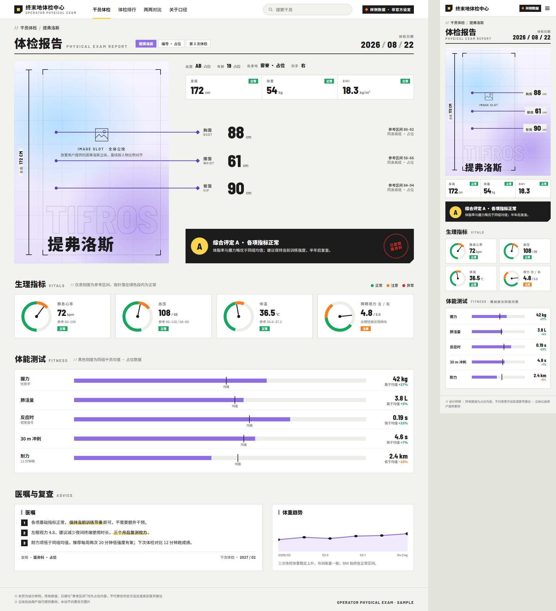
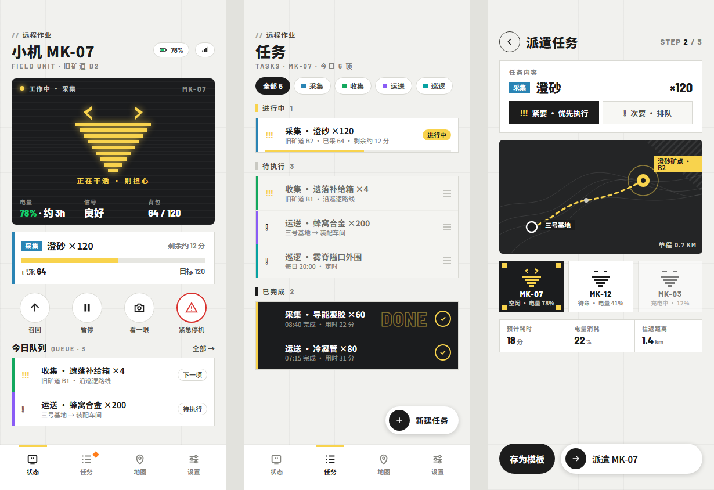
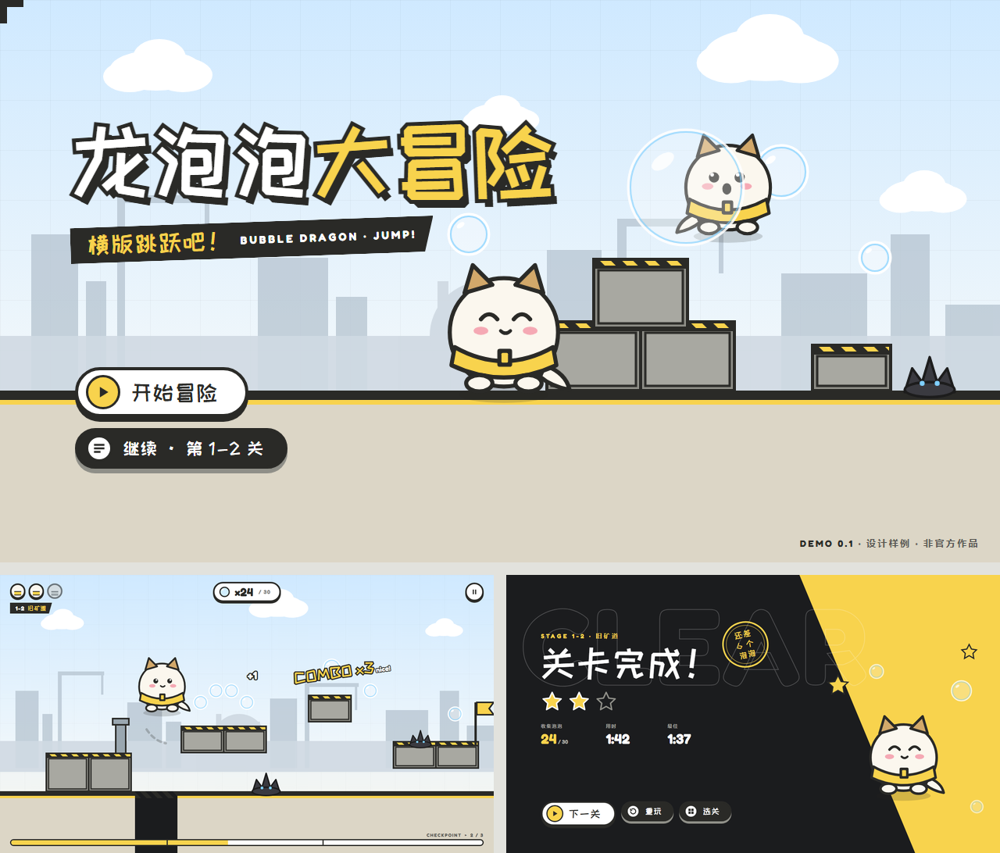

<div align="center">

# Endfield Design Skill

**把《明日方舟：终末地》的视觉语言提炼成可判断、可验证的设计方法**

[](endfield-design/SKILL.md)
[](#-离线与独立运行)
[](endfield-design/references/surface-families.md)
[](#-状态)

</div>

---

## 👋 这是什么

一套面向 Claude Code、Codex 及其他可读取 Skill/Prompt Pack 的模型的 **Design Skill**，基于终末地官网、游戏 UI 与官方运营物料的视觉观察提炼而成。

它让模型在动手前先回答四件事——**做什么（动词）、给谁看（任务）、属于哪个界面家族（结构）、用什么主题锚（颜色）**——然后才选择母题，并在交付前通过一组自检门。聊天页可以用圆角气泡，技能和头像可以用圆形，机械行动区可以用切角，角色或活动页可以换紫、粉、绿、红主题；黄色、切角、括号标题、微缩景观都不是全局必选项。

---

## ✨ 核心机制

| 机制 | 说明 |
|---|---|
| 🧭 **四动词** | Build（新建）· Audit（检查）· Redesign（重构）· Study（提炼）——各有不同交付物与写入权限 |
| 🗺️ **十类界面家族** | HUD/枢纽、地图、角色工作室、仓库/商城、技能树/流程、数据简报、通讯/Wiki、官网、KV、编辑物料 |
| 🎨 **颜色角色表** | 黄=行动选中/进度条 · 橙=通知/倒计时/等级 · 荧光黄绿=增益 chip · 蓝=量值图表 · 青=地区主题 · 红=危险/档案 · 紫=特殊稀有 · 稀有度色阶 蓝→紫→金→橙 |
| 🔷 **形状语义** | 切角=机械/权限 · 圆弧=技能/仪表 · 胶囊=对话/筛选 · 选中=角括号/边条/明暗反转 |
| 📰 **编辑体裁目录** | 日历、档案、说明书、前瞻、期刊、通告、招募、商品目录、主持问答、漫画、数据简报——按阅读任务选择结构 |
| ✍️ **signature** | 每次产出写一句 `verb · family · anchor · theme · stance · signature`，signature 必须来自内容，不是表面母题 |
| 🚦 **八道自检门** | 换题（换内容类型而非题材）、脱皮、家族、语义、克制、真实、可用、版权——任一失败返工 |
| 🧾 **诚实验证** | 视觉 / 响应式 / 交互分别报告 `verified · partial · blocked · not tested` |

---

## 📸 效果预览

三个**原创虚构**的样例项目：题材、家族与体裁互不相同，用同一套方法论各自推导结构，没有共享任何页面骨架。人物立绘位是空白 IMAGE SLOT（仓库不内置官方图片），吉祥物与机器人表情均为原创绘制，所有数值为占位。

### 🏷️ 干员体检中心 · WebUI

> `Build · 信息工具 / 档案型报告 · 锚点：立绘与量线 · 主题：角色紫接管，黄只做导航选中`
> **signature**：三条围度量线从立绘框里穿出来，右侧的数值与线同高——版面本身就是一张裁缝尺寸图。



### 🏷️ 小机远程作业 · 手机 APP

> `Build · 运行枢纽 + 任务列表 · 锚点：机器人的全息表情 · 主题：系统黄`
> **signature**：机器人的表情就是状态——`> <` 工作中、`– –` 待命、`— —` 充电，不靠文字标签。



### 🏷️ 龙泡泡大冒险 · 横版跳跃

> `Build · 活动 KV + 运行 HUD + 完成态反转 · 锚点：龙泡泡本体 · 主题：奶白 + 黄带 + 天蓝`
> **signature**：泡泡既是命也是收集物——HUD 的生命图标与场景里的泡泡同形。



三套样例的源文件（画板 HTML、生成脚本、画布布局与决策记录）都在 [`docs/samples/`](docs/samples/)。

---

## 📁 Skill 结构

```text
endfield-design/
├── SKILL.md                         动词与写入边界、核心 DNA、颜色角色表、路由、自检门与报告格式
└── references/
    ├── surface-families.md          十类界面家族与编辑体裁
    ├── app-ui.md                    APP / 桌面 / 游戏向交互规则与系统 chrome 语法
    ├── web.md                       响应式网站与落地页
    ├── infographic.md               编辑体裁：日历、档案、招募、商品目录、主持问答、漫画等
    ├── imagegen.md                  KV 图像策略与属性化生图提示词
    ├── official-motifs.md           稳定母题、条件母题与主题专用母题
    ├── techniques.md                HTML/CSS 实现技法与语义 token
    ├── engineering.md               固定 HTML 画布截图与验收
    ├── project-context.md           可选的项目级设计上下文模板（仅在用户要求时创建）
    ├── official-sources.md          官网、六个官方社区账号与 Study 采样方法
    ├── source-registry.md           官方来源登记表：类别、可复核性、日期、置信度、派生规则
    └── evidence-map.md              观察 → 规则 的派生关系（维护与 Study 用）
```

```text
docs/
├── previews/                        README 里的三张预览图
├── samples/                         预览图的源文件（画板 + 生成脚本 + 画布布局）
└── research-2026-09-05.md           官网与六个官方账号研究记录、原帖链接及验证范围
```

`endfield-design/` 不包含输出资产、固定品牌页眉、通用页面骨架或组件 gallery。设计结构必须从真实内容与界面家族推导。

---

## 🚀 使用方式

把 `endfield-design/` 放进你的 skills 目录（Claude Code：`~/.claude/skills/` 或项目内 `.claude/skills/`；Codex 同理），然后直接提需求：

> 用终末地风格做一个工业产耗简报页  
> 按终末地设计系统重构这个角色详情页，保留现有数据和路由  
> 审查这张活动长图是否符合终末地视觉语言

若项目需要固定自己的主题、组件与例外，可要求模型生成 `endfield-design-context.md`（格式见 `references/project-context.md`）；项目特例不会回写通用 Skill。

---

## 🔌 离线与独立运行

Build、Audit、Redesign **不需要网络，也不需要任何官方图片**。规则背后的官方观察已登记为文字来源并按可复核程度分级：

- `official-web-observation` — 来自官方网页的观察，保留日期与具体验证范围，网页内容可能变化；
- `official-published-material` — 来自官方公开发布的运营物料，新条目链接原帖，历史条目尚未全部补链；
- `private-game-capture` — 维护者本地实机截图，不随仓库分发，公开读者应视为维护者观察。

Study 可以分析用户提供的新素材，也可以按用户要求探索官方渠道；默认只输出观察报告，明确授权更新后写入 Skill。渠道与账号入口见 [官方来源目录](endfield-design/references/official-sources.md)，本轮结果见 [2026-09-05 研究记录](docs/research-2026-09-05.md)。

---

## 🎯 使用边界

Skill 仅在以下情况自动适用：

- 用户明确要求终末地风格；
- 用户提供终末地参考并要求提取或延续其设计语言；
- 当前项目已经使用这套设计系统。

普通科幻、工业、黑黄或"鹰角感"任务不会仅凭相似关键词自动触发。

---

## 📌 状态

公开测试版。视觉与结构判断已经过样例项目的前向测试；响应式与交互验证将在真实项目中完成。

---

## 📄 权利说明

本项目以 [MIT License](LICENSE) 发布，涵盖本仓库的文档、规则与样例源文件。

本项目是对公开可见的官方视觉语言的**风格属性提炼**。仓库不包含任何官方图片、Logo、角色立绘或专有字体；上方预览图均为原创虚构内容。

> *《明日方舟：终末地》及其全部官方素材版权归鹰角网络（Hypergryph）所有。本项目为非官方的社区工具，与鹰角网络无关联。将本 Skill 的产出用于公开或商业场景前，请自行确认官方商标、角色图片和字体的使用权。*
