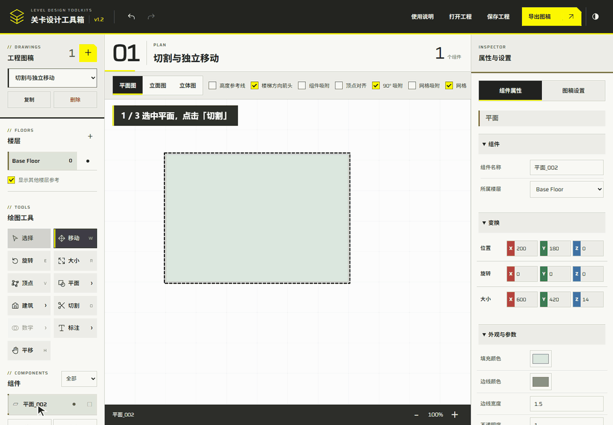
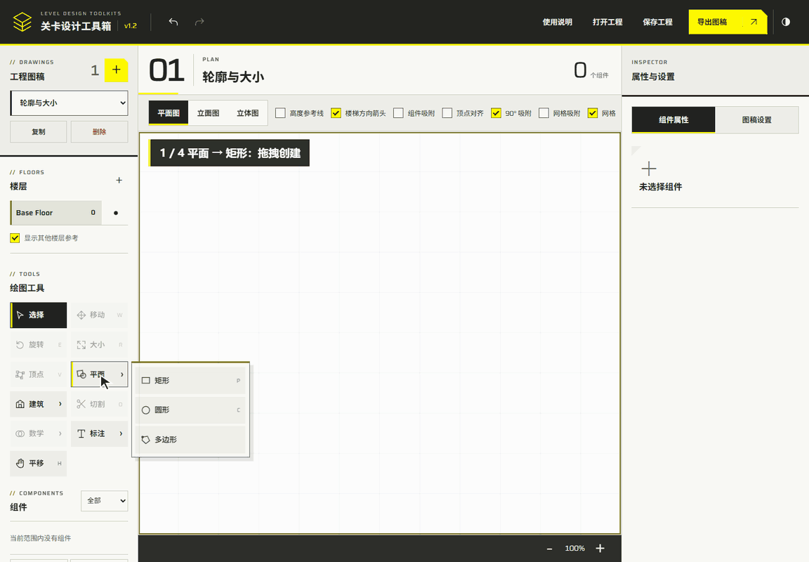
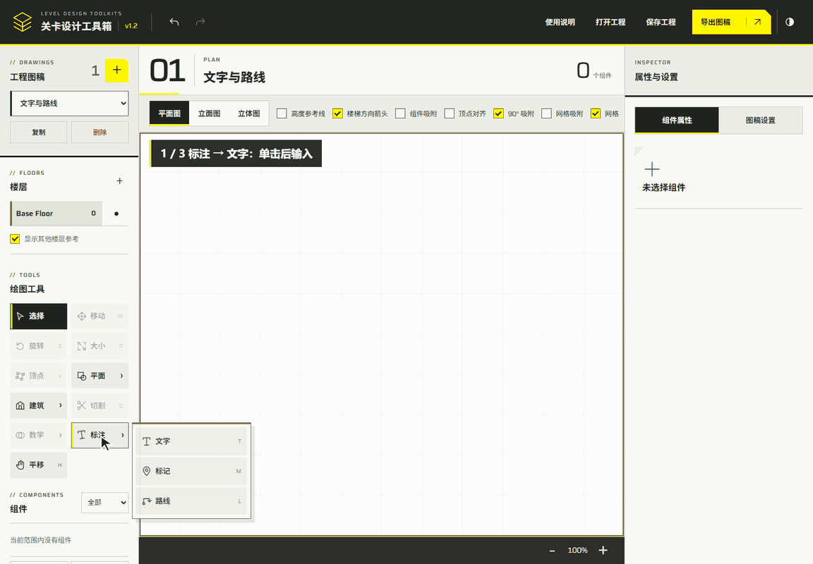
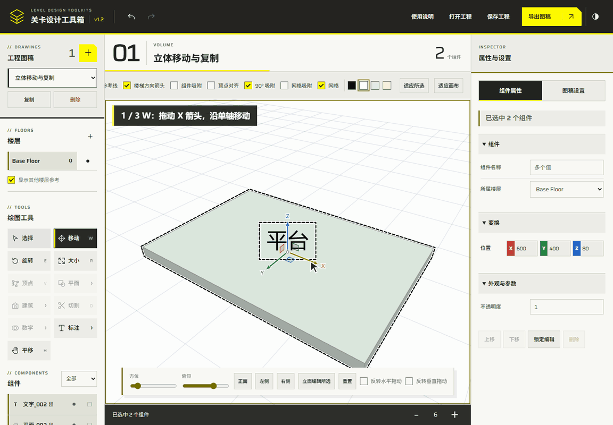
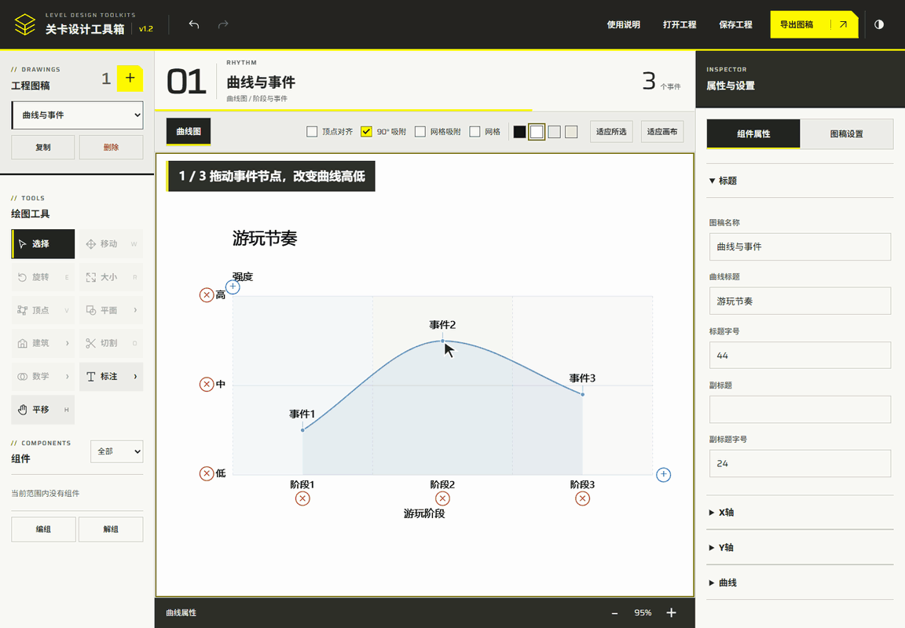
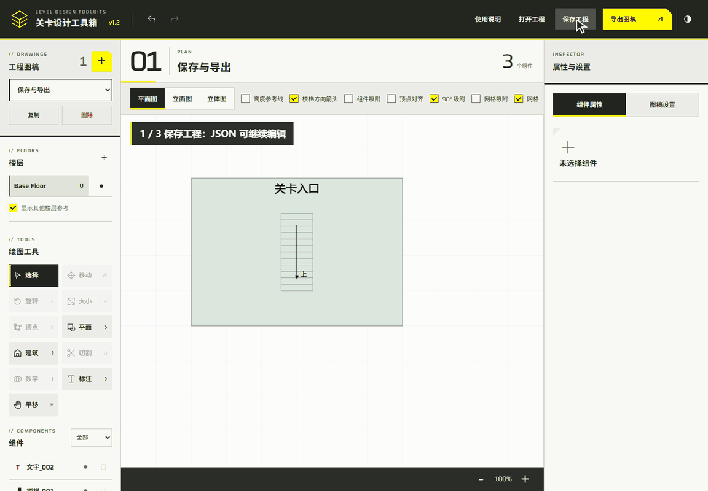

# 关卡设计工具箱 · 使用说明

从搭建场景到导出图稿，按需要查看对应一组。点击演示可播放，再点一次停止。

## 查看与选择

**管理图稿**：在“工程图稿”中点击“新增”，选择空间图或曲线图；使用下拉框切换图稿，点击“复制”或“删除”管理当前图稿。画布标题左侧的两位编号表示当前图稿在工程列表中的顺序，切换平面、立面或立体视图时保持同一图稿号。空间图名称可在右侧“图稿设置”中修改；曲线图的图内标题单独设置。

**界面与面板**：顶部的深浅切换按钮可切换并记住界面主题。窄屏下，用底部“图稿与工具”“编辑画布”“属性与设置”切换面板；选择绘图工具后会自动返回画布。视图、参考线、吸附、背景与取景操作集中在画布上方的单行工具栏，立面与创建选项也在同一行；窗口较窄时可横向滚动，键盘切换焦点时会自动滚动到对应控件。界面主题不改变图稿背景与导出颜色。

**切换视图**：在画面上方选择平面图、立面图或立体图。

**调整画面**：平面图和立面图可用滚轮缩放；立体图固定使用透视，普通滚轮不缩放，靠近/远离通过 W/S 移动相机，保持固定视角。右下角以 m/s 度量摄像机移动速率，只显示数字、不附单位，默认显示 6；整数不补零，小数最多显示小数点后一位。点击“＋”提高速率，点击“−”降低速率，每次乘以或除以 1.25，范围为 0.1–1000 m/s。平面图和立面图的右下角仍显示缩放百分比，加减按钮仍用于缩放。按住中键，或按住空格再拖动，平移画面。透视可在三维空间中靠近和穿过组件，呈现近大远小。未选中组件时，按住 WASD 移动摄像机：W/S 沿视线前进/后退，A/D 左右移动，Q 下降、E 上升；可同时按多个方向，松开停止。透视图选中组件后，按住右键仍可用 WASDQE 移动摄像机，保持当前选择和工具；松开右键立即停止，此时 W/E/R 分别切换组件移动、旋转和调整大小。透视图按住右键拖动可原地转头，俯仰可在 -90°–90° 间调整；右键单击打开菜单。右键导航后松开不会打开菜单。按住右键滚动滚轮，向上加速、向下减速，右下角数值与状态栏同步显示移动速率，此时不会缩放或打开右键菜单。未按住右键时选中组件，或输入文字、切换视图、窗口失焦时停止移动；切换到平面图或立面图后退出透视漫游。

**选择组件**：单击选中，Ctrl＋单击多选；平面图、立面图也可在空白处拖框多选。多选后，单击其中一个组件可只选中它（编组仍整组选中）；平面图、立面图中按住已选组件拖动则保持多选并一起移动。选中组件后，“属性与设置”自动切换到“组件属性”，可手动切回“图稿设置”。单击空白处取消选择。

**筛选组件**：在左侧“组件”标题旁的下拉框中，按平面、墙壁、集合实体、楼梯、爬梯、旋转楼梯、文字、标记或路线筛选当前楼层的组件（平面图多选楼层时包含所有所选层）；选择“全部”恢复完整列表。矩形、圆形、多边形和自由图形均归入“平面”，交集或差集产生的组件归入“集合实体”。筛选只改变列表显示，不改变画布可见性、已选组件或撤销历史。

**选择整组或单件**：画布中选择整组；需要单独编辑时，在左侧组件列表选择单件。先点击 A，再按住 Shift 点击 B，可按当前列表顺序选中 A 到 B 的全部组件；继续 Shift 点击可调整范围，Ctrl＋Shift 点击可将范围加入已有选择。范围只包含当前楼层（平面图为所选楼层）和筛选中列出的组件。双击列表中的名称可改名。

**组件操作**：平面图、立面图和立体图均可编组、解组：多选组件后，点击左侧组件列表下方的“编组”，或按 Ctrl＋G；选中编组后点击“解组”，或按 Ctrl＋Shift＋G。右键菜单也提供这两项操作；锁定组件须先解锁。复制、粘贴可使用 Ctrl＋C / Ctrl＋V，复制副本可从右键菜单操作。右侧组件属性底部将“上移”“下移”“锁定”和“删除”排成一行四个按钮；组件锁定后，“锁定”显示为“解锁”。顶点编辑从左侧工具栏进入。

**组件命名**：新建组件按类型和三位编号命名，例如“平面_001”“墙壁_001”；同类型继续递增，并避开旧工程已有编号。复制副本、粘贴、Alt 拖动复制及复制楼层中的组件保留来源名称，例如“入口平台_副本_001”；切割、交集、差集生成“入口平台_切割_001”“入口平台_交集_001”“入口平台_差集_001”。重复同类操作继续编号，避免反复堆叠相同后缀。双击组件列表名称或在右侧修改“组件名称”，点号和中点统一替换为下划线，连续下划线合并，同一图稿内重名自动顺延；多选改名也会逐件分配唯一名称，空名称不提交。读取旧工程或恢复暂存时同样整理点号和重名，已有符合规则且不重名的名称保留；组件名称与文字内容、路线标签及曲线事件名称分别编辑。

**排列组件顺序**：在组件属性底部或右键菜单点击“上移”“下移”，每次在当前列表的同级组件间调整一位；多选保留所选组件之间的顺序，到达边界后不再移动。也可按住组件列表中的名称上下拖动，松开后插入指示线位置；拖动已选中的组件可一起排列当前列表中选中的同级组件，保留它们之间的顺序。列表上方对应更靠前的层叠顺序，场景仍遵循空间深度。宿主和附属空洞一起移动，空洞仅在同一宿主内排序，不改变归属；锁定组件需先解锁。Esc、移出列表松开或切换窗口可取消拖动，Ctrl＋Z 撤销，排序随 JSON 工程与自动暂存保存。

**网格与网格吸附**：在“图稿设置 → 网格”修改“每格/cm”，默认 100 厘米，随 JSON 工程保存。每格代表的世界尺寸固定，滚轮缩放只改变屏幕显示大小；过密的网格线会隐藏，不会换成另一种单位间距。“网格”控制显示，“网格吸附”控制编辑，两者可独立开关；网格吸附默认开启，可手动关闭。

## 创建组件与逐点切割

**矩形、圆形和墙壁**：鼠标悬停左侧“平面”时，按钮有短促动效并弹出“矩形”“圆形”“多边形”菜单；也可点击展开，或聚焦按钮后按 Enter、空格或方向键展开，用上下方向键选择、Enter 确认，Esc 收起。“墙壁”仍直接选择。矩形、圆形选好工具后，按住左键拖出范围，松开完成。“矩形”快捷键为 P，按住 Shift 画正方形；“圆形”快捷键为 C，可拖出椭圆，按住 Shift 画正圆。矩形、圆形创建后可以继续拖拽创建下一个。墙壁在平面图中改为沿边放置：点击“墙壁”进入放置状态，将鼠标移到当前楼层可见且未锁定的组件直边附近，整条边高亮，单击沿该边生成独立墙壁；墙根跟随边缘位置、高度与方向，长度不受网格吸附改变，默认高度 180、厚度 18，可在属性中继续调整。支持连续点击不同边缘放置；空白处或组件内部点击不创建，圆形、椭圆及曲线段不作为直边。按 Esc 或右键退出，切换工具、视图、楼层或图稿取消待放置状态，Ctrl＋Z 一次撤销一面墙壁。选择“多边形”后，在平面图中依次点击取点；至少三个顶点后点击首点闭合并创建，也可按 Enter 或“完成绘制”闭合。绘制时显示轮廓预览，Backspace / Delete 退一个点，Esc 或右键取消；切换工具、视图、楼层或图稿也会取消未完成的轮廓。网格吸附开启时逐点对齐网格，按住 Ctrl / Command 暂停吸附。边线相交、重叠、回折或无面积时不会创建，可退点修改。创建后自动选中并进入顶点编辑，Ctrl＋Z 一次撤销整个多边形。

**自由图形**：在左侧“平面”菜单选择“自由图形”，进入自由绘制状态；按住鼠标左键沿轮廓绘画，松开后自动连接起点和终点，生成闭合的平面组件，可连续绘制多个。绘制中显示笔迹和闭合区域预览，自动精简密集的采样点，网格吸附不改变自由笔迹。生成的图形使用当前楼层的高度和默认颜色，与其他平面一样可选择、移动、调整大小、编辑顶点及保存工程。单击不拖动、无面积或边线相交、重叠、回折的笔迹不会生成组件，可重新绘制。Esc、右键、指针取消、切换窗口或切换工具、视图、楼层、图稿会取消未完成的绘制；Ctrl＋Z 一次撤销一个图形。自由绘制仅在空间图的平面图中可用。

**切换与排列楼层**：点击左侧楼层名称可切换并选择该层组件；在非输入状态下，按数字键 1–9 切换列表中的第 1–9 层，0 切换第 10 层，也支持开启 Num Lock 的数字小键盘。不存在的楼层不响应，输入文字、改名、中文输入和打开对话框时不会切换。按住 Ctrl / Command 点击可多选或取消单层，Shift 点击按列表顺序连续选择，Ctrl / Command＋Shift 可追加连续范围；平面图会同时显示所选楼层的组件，并可从画布或组件列表点选；隐藏楼层仍保持隐藏，未选楼层仅在开启“其他楼层”时作为淡色参考显示。这些选择也用于楼层列表的批量排序，保留当前编辑楼层与画布组件选择。普通点击或数字快捷键恢复单层选择。按住楼层名称上下拖动，松开后插入指示线位置；拖动已选楼层可一起排列选中的楼层并保持相对顺序，数字快捷键随新列表顺序更新。排序只调整列表顺序，保留楼层名称、高度、可见性、配色、组件归属及当前画布选择；Ctrl＋Z 一次撤销，随 JSON 工程和自动暂存保存。Esc、移出列表松开或切换窗口可取消拖动，长列表拖到面板边缘可自动滚动。

**楼层默认名称**：新建空间图的初始层名为 Base Floor，后续新增或复制的楼层依次命名为 Floor 1、Floor 2 等；已有同名楼层时跳过该编号。可双击左侧楼层名称，或在“图稿设置 → 当前楼层”中改名。载入已有工程保留其保存的楼层名称。

**楼层默认颜色**：同一楼层新建的平面（矩形、圆形、多边形、自由图形）、墙壁、楼梯、爬梯和旋转楼梯默认使用相同颜色；新增楼层自动分配配色。在“图稿设置 → 当前楼层”中修改“新增组件默认颜色”，只影响该层后续新建的实体，边线自动使用对应深色；已有组件颜色不变。默认色支持撤销、重做，并随 JSON 工程和自动暂存保存。可在组件属性中单独改色，后续新建仍使用该层默认色。复制保留原组件颜色；旧工程已有颜色保持不变，该层以首个实体的颜色作为后续新建的默认色。文字、路线和标记沿用各自的标注配色。

**切割 / O**：先选中一个未锁定的平面或墙壁，再点击切割工具或按 O，鼠标变为剪刀。逐点点击组件内部或边缘，边缘会自动吸附；点击首点闭合，或切割线将组件分开时自动完成，保留所有切下的部分，并选中生成的两个或多个独立组件。未完成时按 Backspace 或 Delete 退一个点，Esc 或右键取消；切换工具、视图或图稿也会取消，Ctrl＋Z 一次撤销整次切割。切割保留颜色、厚度、楼层和原有开口，拆分后的组件可以单独选择和移动。带旧版斜向开口的组件暂不支持切割；有普通开口的墙体请在开口所在墙面操作。平面沿自身表面切割，墙壁可在平面图切占地、立面图切墙面；立体图可在可见的对应切割面操作。楼梯、路线、文字、锁定、多选或侧向无可见面积时不可切割。

**数学 / 交集与差集**：选中至少两个可见且未锁定的实体，在左侧悬停或点击“数学”，选择“交集”或“差集”后立即执行；平面、墙壁、楼梯、爬梯、旋转楼梯及集合结果都可参加，三视图均可操作。交集只保留所有所选实体共同占据的体积，不相交时删除所选实体；差集删除任意两件的重叠体积，保留其余部分。完全被另一件包裹的组件会从外层实体中扣除其占用体积，形成内部空腔或贯穿孔，内层组件删除；完全重合的组件均删除。不相交的差集保持原样。运算按实际三维体积判断，画面投影重叠但高度分离不会相交。附属空洞一并计算并融入结果，隐藏或锁定的空洞须先显示并解锁；同组选中的文字、路线和标记保留。修改后的部分成为集合实体，保留来源颜色、楼层和位置，可移动、旋转、调整三轴大小、复制、再次集合及保存工程，不再提供原组件的踏步或独立顶点参数。Ctrl＋Z 一次撤销整次操作。

**结束创建**：按 Esc 或右键退出。也可单击组件退出并选中它；单击空白处退出并保留最新创建的组件。

## 放置楼梯与标记

**拖拽放置**：墙壁与各类梯子统一放在左侧“建筑”菜单中；悬停或点击“建筑”，选择“墙壁”“楼梯”“爬梯”或“旋转楼梯”。“标记”在“标注”菜单中，与“文字”“路线”放在一起。这些分组支持点击、键盘或触屏展开，选中子工具后菜单自动收起，窄屏下返回编辑画布。楼梯和爬梯与矩形平面一样，按住左键拖出矩形范围，松开创建；按住 Shift 约束为正方形。旋转楼梯在平面图中拖出正圆占地，无需按 Shift，松开创建；内外半径保持比例。立面图中拖出楼梯、爬梯或旋转楼梯的宽度和高度。标记仍为移动到需要的位置后单击放置。

**继续或结束**：同一工具可连续拖拽创建多个组件；网格吸附和 Ctrl / Command 暂停吸附与平面一致。拖动中按 Esc、右键或切换工具、视图、楼层、图稿会取消未完成的创建；单击不拖动则返回选择，Ctrl＋Z 一次撤销一个组件。

## 移动与调整形状

**移动**：在平面图、立面图中选中组件，拖动到需要的位置。

**顶点**：选择“顶点”，拖动角点调整轮廓；点击边上的小圆点可添加顶点。楼梯相邻角点重合后可形成三角形，踏步保持平行、等距；在立面图拖动重合点时，同端高度一起变化。

**大小**：选择“大小”（R），在平面图或立面图拖边只调整一个尺寸，拖角可分别调整两个可见尺寸；横向或纵向拖动角点可单独拉长一边。矩形和实体包围框的对角点固定；按住 Shift 等比缩放，松开后恢复分别调整。网格吸附只取整本次改变的尺寸；Shift 等比时以较长的所改尺寸取整格，其余尺寸保持比例。圆弧和旋转楼梯仍保留圆形约束。

**旋转**：选择“旋转”，拖动圆环调整方向。Ctrl 可临时暂停吸附。

**按整格搭建**：开启“网格吸附”后，新建实体自动对齐网格边界，长宽高取整格；移动时比较主组件包围框在各移动方向上的两侧边界，选离网格更近的一侧对齐，左、右、上、下边均可吸附，方向键移动也遵循此规则。画布尺寸手柄将所改尺寸取为至少一格；属性编辑器的尺寸输入和数值拖动不受网格限制，单选、多选均可设置非整格或小于一格的尺寸。该模式优先于组件边吸附。已有组件不会在开关切换时批量改变；多选移动保持相对位置。旋转保留本地方向，文字字号、标记图标和楼梯内部细节不按整格放大。Ctrl 临时暂停，Esc 取消，Ctrl＋Z 撤销。

## 添加文字与路线

**文字**：选择“文字”，单击画面后输入内容。双击已有文字可修改内容，在编辑框旁或右侧属性中调整字号。

**路线**：按 L 或选择“路线”，依次点击添加节点，按 Enter 或双击结束，也可点击画布底部的“完成绘制”；“取消”可退出绘制。立体图中，绘制提示与按钮显示在相机控制栏上方。选中路线后，直接拖动节点调整走向，立体图中的节点会贴合鼠标指向的可见实体表面。

**增删路线节点**：点击节点之间的小圆点添加节点；点中一个节点后按 Delete 删除该节点。

## 立体图中的移动、旋转与尺寸

**沿轴移动**：选中组件后按 W，拖动 X、Y、Z 箭头沿世界轴移动；也可点击左侧“移动”。移动、旋转、大小的主手柄共用组件本地包围框的最小 X/Y/Z 角点，切换 W/E/R 或转动视角时保持同一个角点；旋转以该角点为轴心。多选移动与旋转共用所选实体整体世界包围框的最小 X/Y/Z 角点。

**沿平面移动**：拖动两轴之间的小方块，沿对应平面移动。手柄置灰时，转动视角后再操作。

**拖动复制**：按住 Alt 开始拖动坐标手柄，松开后放置副本；按 Esc 取消本次操作。

**三轴旋转**：选中实体后按 E，拖动 X/Y/Z 圆环绕对应世界轴旋转。编组、多选或整层可一起旋转，空洞随宿主旋转。Shift 每次旋转 15°，Ctrl 暂停吸附；Esc 取消，Ctrl＋Z 撤销。

**以共用角点调整尺寸**：选择单个实体后按 R，拖动共用角点处的本地 X/Y/Z 手柄只改一个尺寸，组件以该角点为基点向另一侧伸缩、共用角点固定。也可直接拖动包围框角点改变长宽高，此时对角点固定，沿当前视角最清晰的两个本地轴调整；点击其他角点不会改变主轴所用的共用角点。网格吸附开启时，所改尺寸按图稿设置中的网格大小取整格，Ctrl 暂停。旋转楼梯和圆弧保持圆形，两径向尺寸联动。多实体或整层请在组件列表选单件后调整。

**编辑属性**：属性编辑器按“组件”“变换”“外观与参数”分组，可折叠。数值框首次单击全选数字，可直接输入替换；保持焦点再次单击可将光标定位到某一位，拖动可选取部分数字，离开后再次单击重新全选。用 Tab 进入数值框也会全选。实体的“变换”中，位置、旋转、大小各有 X/Y/Z 三个输入框；位置为组件原点坐标，Z 相对所属楼层，旋转单位为“度”，大小沿组件本地轴计算长宽高。矩形修改 X/Y 大小（直接输入、横向拖动或粘贴）时，固定本地 X/Y 负向边，只向正向一侧伸长或缩短；未旋转时即固定左边和上边，旋转后跟随矩形自身方向，多选时各矩形分别固定自身起始边。平面厚度通过“大小”的 Z 值调整，上表面保持固定。输入只修改对应轴，位置数值精确设置原点；单选、多选的尺寸及厚度、宽度、半径、高度等参数均不按网格取整，可输入小数和小于一格的有效尺寸。圆弧和旋转楼梯的径向尺寸保持联动。修改同步到三个视图，支持撤销、重做。

**拖动变换数值**：在“变换”中，无需先点击，直接按住尚未进入输入状态的数值框左右拖动即可调值，向右增大、向左减小；单击松开才会全选数字并进入输入状态，之后可再次单击定位光标或拖选文本。X/Y/Z 色块始终支持直接拖动调值。按住 Shift 拖动数值框或色块可精细调整，尺寸数值拖动不受网格吸附限制，无需按住 Ctrl/Command。多选时拖动给各组件增加相同变化量，保留原有差值；直接输入仍统一设值。一次拖动只记一次撤销，Esc 取消，松开鼠标提交。

**快捷复制粘贴属性**：在“变换”和“外观与参数”中，按住 Shift 并右键单击属性名称或输入框复制，Shift＋左键单击目标项粘贴。鼠标悬停时对应属性栏轻微变色，复制或粘贴成功后整栏短暂闪亮，再恢复原样；开启减少动态效果时改为短暂静态提示。位置、旋转、大小可点击行标题复制或粘贴整组三轴，也可在单个轴的输入框或 X/Y/Z 色块操作。数值可粘贴到其他数值项，颜色、文字和下拉选项分别匹配同类控件；整组三轴须粘贴到对应的变换行。属性使用本次打开页面内的独立剪贴板，可跨组件和图稿使用，不影响 Ctrl＋C / Ctrl＋V 的组件复制。多选粘贴统一设值，一次粘贴可一次撤销；“多个值”不能复制，锁定组件不能粘贴，类型不匹配、无效选项、超出范围或几何无效时保持原值。Shift 单击松开后粘贴，Shift 左右拖动仍为精细调整。

**多选属性**：多选时显示所有所选组件的共有属性：相同值直接显示，不同值显示“多个值”，不取最后选中组件的值。输入新值会统一设置各组件的对应属性，保留其他轴；一次批量编辑可一次撤销。不同类型仅显示共同支持的字段；选择中有锁定组件时禁止修改。附属空洞随宿主变换，不重复参与宿主的属性汇总；独立选择空洞仍可编辑其自身属性。

**其他编辑**：文字和路线仍可直接拖动；文字可用圆环旋转，在属性中调整字号。标记通过属性调整半径。实体独立轮廓顶点编辑、独立空洞编辑请切回平面图或立面图；空洞随所在平面或墙壁一起移动、旋转和调整尺寸。

## 绘制曲线与编辑事件

**调整曲线**：新建图稿时选择“曲线图”。拖动事件节点，调整事件的位置和曲线高低。

**编辑事件**：双击事件文字修改名称；右侧“＋事件”可添加节点，点击曲线后也可用节点间的白点添加。

**整理图表**：在右侧展开标题、X 轴、Y 轴或曲线，修改对应内容。拖动事件名称左侧的六点手柄，调整名称顺序。

## 保存工程与导出图片、模型

**继续编辑用工程文件**：点击“保存工程”或按 Ctrl＋S（Mac 为 Command＋S）保存 JSON。首次保存选择文件位置，之后再次保存会更新同一文件。Chrome、Edge 会记住当前暂存工程的保存文件，关闭浏览器后再次打开并自动恢复工程，保存仍会更新原文件；浏览器可能要求重新授予原文件的写入权限。打开另一份工程后需重新选择位置。JSON 工程也可通过“打开工程”恢复。

**浏览器保存兼容性**：建议使用 Chrome、Edge 选择位置并快速保存；清理浏览器本地数据、网页地址改变或原文件失效时需重新选择位置。不支持文件保存接口的浏览器会使用下载保存，位置及是否询问由浏览器下载设置决定。

**分享图片用导出图稿**：选择 PNG 或 SVG。完整图稿包含当前视图规则下的全部可见组件。

**只导出一部分**：PNG / SVG 选择“当前视野”，在预览中滚轮缩放、拖动取景，点击“导出文件”保存当前看到的画面。

**导出三维模型**：空间图点击“导出图稿”，文件格式选择 FBX 或 OBJ，再点击“导出文件”。导出所有可见楼层的平面、墙壁、楼梯、爬梯和旋转楼梯，保留空洞、位置、旋转及楼层高度。模型不受当前平面/立面/立体视图、选中范围或预览取景裁切影响；隐藏组件和隐藏楼层不导出。

**模型内容与单位**：两种格式均输出分对象的三角网格和法线，Z 轴向上，坐标数值 1:1；二进制 FBX 7.4 的单位为厘米，并携带组件基础颜色及透明度。OBJ 仅含几何，不生成材质文件。文字、路线、标记、网格和编辑辅助线不导出；曲线图请使用 PNG / SVG。

## 常用快捷键

- 切割组件 / 退一个取点：O / Backspace
- 绘制矩形 / 圆形：P / C
- 保存工程：Ctrl＋S / Command＋S
- 组件工具（透视图须松开右键）：W 移动 / E 旋转 / R 调整大小
- 立体图摄像机（透视图选中组件时须按住右键）：W/S 沿视线前进/后退，A/D 左右，Q 下降 / E 上升；右键＋滚轮调速，右键拖动转头
- 切换楼层（按列表顺序）：1–9 对应第 1–9 层，0 对应第 10 层
- 绘制路线：L
- 撤销 / 重做：Ctrl＋Z / Ctrl＋Shift＋Z
- 删除组件：选中组件后按 Delete
- 复制 / 粘贴：Ctrl＋C / Ctrl＋V
- 编组 / 解组：Ctrl＋G / Ctrl＋Shift＋G
- 退出当前操作：Esc

工具快捷键请使用英文输入法；按键标在左侧工具按钮或分组菜单中。文字输入期间不会切换工具。
