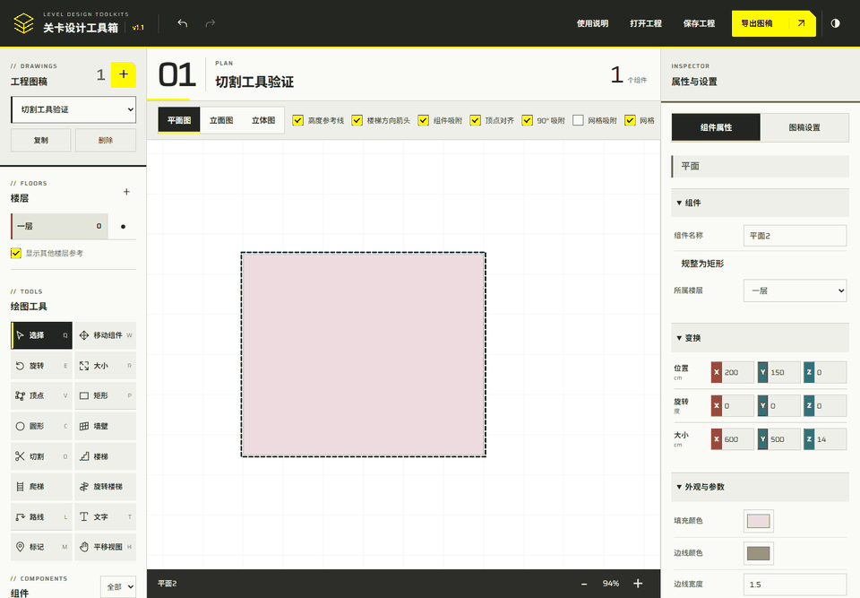
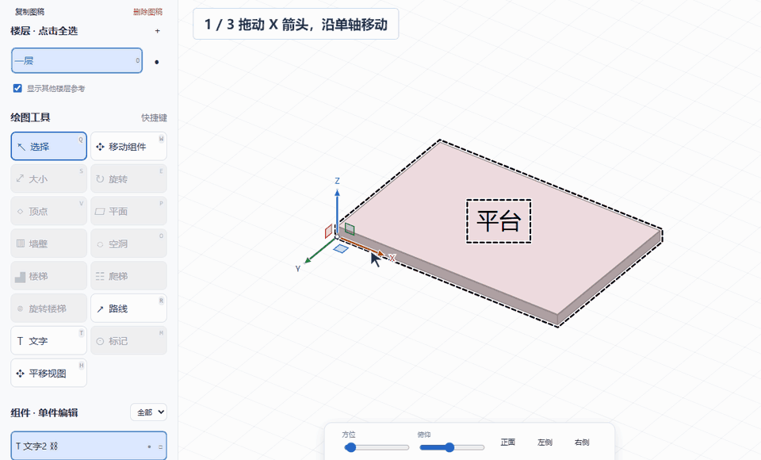
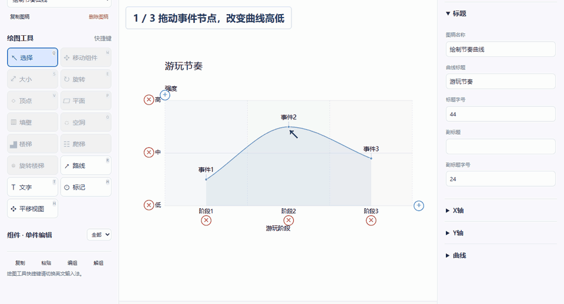
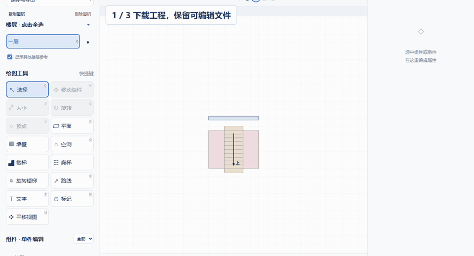

# 关卡设计工具箱 · 使用说明

从搭建场景到导出图稿，按需要查看对应一组。点击演示可播放，再点一次停止。

## 查看与选择

**管理图稿**：在“工程图稿”中点击“新增”，选择空间图或曲线图；使用下拉框切换图稿，点击“复制”或“删除”管理当前图稿。画布标题左侧的两位编号表示当前图稿在工程列表中的顺序，切换平面、立面或立体视图时保持同一图稿号。空间图名称可在右侧“图稿设置”中修改；曲线图的图内标题单独设置。

**界面与面板**：顶部的深浅切换按钮可切换并记住界面主题。窄屏下，用底部“图稿与工具”“编辑画布”“属性与设置”切换面板；选择绘图工具后会自动返回画布。视图、参考线、吸附、背景与取景操作集中在画布上方的单行工具栏，立面与创建选项也在同一行；窗口较窄时可横向滚动，键盘切换焦点时会自动滚动到对应控件。界面主题不改变图稿背景与导出颜色。

**切换视图**：在画面上方选择平面图、立面图或立体图。

**调整画面**：滚轮缩放；按住中键，或按住空格再拖动，平移画面。立体图中按住右键拖动转动视角；右键单击仍打开菜单。

**选择组件**：单击选中，Ctrl＋单击多选；平面图、立面图也可在空白处拖框多选。多选后，单击其中一个组件可只选中它（编组仍整组选中）；平面图、立面图中按住已选组件拖动则保持多选并一起移动。选中组件后，“属性与设置”自动切换到“组件属性”，可手动切回“图稿设置”。单击空白处取消选择。

**选择整组或单件**：画布中选择整组；需要单独编辑时，在左侧组件列表选择单件。先点击 A，再按住 Shift 点击 B，可按当前列表顺序选中 A 到 B 的全部组件；继续 Shift 点击可调整范围，Ctrl＋Shift 点击可将范围加入已有选择。范围只包含当前楼层和筛选中列出的组件。双击列表中的名称可改名。

**组件操作**：左侧组件列表下方提供“编组”和“解组”；复制、粘贴可使用 Ctrl＋C / Ctrl＋V，复制副本可从右键菜单操作。右侧组件属性底部提供“上移”“下移”“锁定编辑”和“删除”；顶点编辑从左侧工具栏进入。

**排列组件顺序**：在组件属性底部或右键菜单点击“上移”“下移”，每次在当前列表的同级组件间调整一位；多选保留所选组件之间的顺序，到达边界后不再移动。也可按住组件列表中的名称上下拖动，松开后插入指示线位置；拖动已选中的组件可一起排列当前列表中选中的同级组件，保留它们之间的顺序。列表上方对应更靠前的层叠顺序，场景仍遵循空间深度。宿主和附属空洞一起移动，空洞仅在同一宿主内排序，不改变归属；锁定组件需先解锁。Esc、移出列表松开或切换窗口可取消拖动，Ctrl＋Z 撤销，排序随 JSON 工程与自动暂存保存。

**网格与网格吸附**：在“图稿设置 → 网格”修改“每格/cm”，默认 100 厘米，随 JSON 工程保存。每格代表的世界尺寸固定，滚轮缩放只改变屏幕显示大小；过密的网格线会隐藏，不会换成另一种单位间距。“网格”控制显示，“网格吸附”控制编辑，两者可独立开关；网格吸附默认开启，可手动关闭。

## 创建组件与逐点切割

**矩形、圆形和墙壁**：在左侧分别选择“矩形”“圆形”或“墙壁”，按住左键拖出范围，松开完成。“矩形”快捷键为 P，按住 Shift 画正方形；“圆形”快捷键为 C，可拖出椭圆，按住 Shift 画正圆。创建后可以继续拖拽创建下一个。

**切割 / O**：先选中一个未锁定的平面或墙壁，再点击切割工具或按 O，鼠标变为剪刀。逐点点击组件内部或边缘，边缘会自动吸附；点击首点闭合，或切割线将组件分开时自动完成，保留所有切下的部分，并选中生成的两个或多个独立组件。未完成时按 Backspace 或 Delete 退一个点，Esc 或右键取消；切换工具、视图或图稿也会取消，Ctrl＋Z 一次撤销整次切割。切割保留颜色、厚度、楼层和原有开口，拆分后的组件可以单独选择和移动。带旧版斜向开口的组件暂不支持切割；有普通开口的墙体请在开口所在墙面操作。平面沿自身表面切割，墙壁可在平面图切占地、立面图切墙面；立体图可在可见的对应切割面操作。楼梯、路线、文字、锁定、多选或侧向无可见面积时不可切割。

**结束创建**：按 Esc 或右键退出。也可单击组件退出并选中它；单击空白处退出并保留最新创建的组件。

## 放置楼梯与标记

**点击放置**：选择楼梯、爬梯、旋转楼梯或标记，移动到需要的位置，单击放置。

**继续或结束**：同一工具可连续放置多个组件；按 Esc 或右键结束。

## 移动与调整形状

**移动**：在平面图、立面图中选中组件，拖动到需要的位置。

**顶点**：选择“顶点”，拖动角点调整轮廓；点击边上的小圆点可添加顶点。

**大小**：选择“大小”（R），在平面图或立面图拖边只调整一个尺寸，拖角可分别调整两个可见尺寸；横向或纵向拖动角点可单独拉长一边。矩形和实体包围框的对角点固定；按住 Shift 等比缩放，松开后恢复分别调整。网格吸附只取整本次改变的尺寸；Shift 等比时以较长的所改尺寸取整格，其余尺寸保持比例。圆弧和旋转楼梯仍保留圆形约束。

**旋转**：选择“旋转”，拖动圆环调整方向。Ctrl 可临时暂停吸附。

**按整格搭建**：开启“网格吸附”后，新建实体自动对齐网格边界，长宽高取整格；移动按组件包围框边界对齐，尺寸拖拽将所改尺寸取为至少一格，右侧尺寸属性同样遵循网格。该模式优先于组件边吸附。已有组件不会在开关切换时批量改变；多选移动保持相对位置。旋转保留本地方向，文字字号、标记图标和楼梯内部细节不按整格放大。Ctrl 临时暂停，Esc 取消，Ctrl＋Z 撤销。

## 添加文字与路线

**文字**：选择“文字”，单击画面后输入内容。双击已有文字可修改内容，在编辑框旁或右侧属性中调整字号。

**路线**：按 L 或选择“路线”，依次点击添加节点，按 Enter 或双击结束。选中路线后，直接拖动节点调整走向。

**增删路线节点**：点击节点之间的小圆点添加节点；点中一个节点后按 Delete 删除该节点。

## 立体图中的移动、旋转与尺寸

**沿轴移动**：选中组件后按 W，拖动 X、Y、Z 箭头沿世界轴移动；也可点击左侧“移动组件”。

**沿平面移动**：拖动两轴之间的小方块，沿对应平面移动。手柄置灰时，转动视角后再操作。

**拖动复制**：按住 Alt 开始拖动坐标手柄，松开后放置副本；按 Esc 取消本次操作。

**三轴旋转**：选中实体后按 E，拖动 X/Y/Z 圆环绕对应世界轴旋转。编组、多选或整层可一起旋转，空洞随宿主旋转。Shift 每次旋转 15°，Ctrl 暂停吸附；Esc 取消，Ctrl＋Z 撤销。

**角点调整尺寸**：选择单个实体后按 R，拖动包围框角点改变长宽高，对角点固定；点击一个角点后，拖旁边的本地 X/Y/Z 手柄只改一个尺寸。直接拖角点沿当前视角最清晰的两个本地轴调整；网格吸附开启时，所改尺寸按图稿设置中的网格大小取整格，Ctrl 暂停。旋转楼梯和圆弧保持圆形，两径向尺寸联动。多实体或整层请在组件列表选单件后调整。

**编辑属性**：属性编辑器按“组件”“变换”“外观与参数”分组，可折叠。实体的“变换”中，位置、旋转、大小各有 X/Y/Z 三个输入框；位置为组件原点坐标，Z 相对所属楼层，旋转单位为“度”，大小沿组件本地轴计算长宽高。平面厚度通过“大小”的 Z 值调整。输入只修改对应轴，位置数值精确设置原点，尺寸仍遵循网格吸附；圆弧和旋转楼梯的径向尺寸保持联动。修改同步到三个视图，支持撤销、重做。

**拖动变换数值**：在“变换”中按住任意数值框或 X/Y/Z 色块左右拖动，向右增大、向左减小；单击数值仍可直接输入。按住 Shift 精细调整，尺寸拖动遵循网格吸附，Ctrl/Command 临时暂停网格。多选时拖动给各组件增加相同变化量，保留原有差值；直接输入仍统一设值。一次拖动只记一次撤销，Esc 取消，松开鼠标提交。

**多选属性**：多选时显示所有所选组件的共有属性：相同值直接显示，不同值显示“多个值”，不取最后选中组件的值。输入新值会统一设置各组件的对应属性，保留其他轴；一次批量编辑可一次撤销。不同类型仅显示共同支持的字段；选择中有锁定组件时禁止修改。附属空洞随宿主变换，不重复参与宿主的属性汇总；独立选择空洞仍可编辑其自身属性。

**其他编辑**：文字和路线仍可直接拖动；文字可用圆环旋转，在属性中调整字号。标记通过属性调整半径。实体独立轮廓顶点编辑、独立空洞编辑请切回平面图或立面图；空洞随所在平面或墙壁一起移动、旋转和调整尺寸。

## 绘制曲线与编辑事件

**调整曲线**：新建图稿时选择“曲线图”。拖动事件节点，调整事件的位置和曲线高低。

**编辑事件**：双击事件文字修改名称；右侧“＋事件”可添加节点，点击曲线后也可用节点间的白点添加。

**整理图表**：在右侧展开标题、X 轴、Y 轴或曲线，修改对应内容。拖动事件名称左侧的六点手柄，调整名称顺序。

## 保存工程与导出图片、模型

**继续编辑用工程文件**：点击“保存工程”或按 Ctrl＋S（Mac 为 Command＋S）保存 JSON。首次保存选择文件位置，本次打开期间再次保存会直接更新同一文件；打开另一份工程或重新启动后，首次保存重新选择位置。下次点击“打开工程”恢复。

**浏览器保存兼容性**：建议使用 Chrome、Edge 或桌面版选择位置并快速保存。不支持文件保存接口的浏览器会使用下载保存，位置及是否询问由浏览器下载设置决定。

**分享图片用导出图稿**：选择 PNG 或 SVG。完整图稿包含当前视图规则下的全部可见组件。

**只导出一部分**：PNG / SVG 选择“当前视野”，在预览中滚轮缩放、拖动取景，点击“导出文件”保存当前看到的画面。

**导出三维模型**：空间图点击“导出图稿”，文件格式选择 FBX 或 OBJ，再点击“导出文件”。导出所有可见楼层的平面、墙壁、楼梯、爬梯和旋转楼梯，保留空洞、位置、旋转及楼层高度。模型不受当前平面/立面/立体视图、选中范围或预览取景裁切影响；隐藏组件和隐藏楼层不导出。

**模型内容与单位**：两种格式均输出分对象的三角网格和法线，Z 轴向上，坐标数值 1:1；二进制 FBX 7.4 的单位为厘米，并携带组件基础颜色及透明度。OBJ 仅含几何，不生成材质文件。文字、路线、标记、网格和编辑辅助线不导出；曲线图请使用 PNG / SVG。

## 常用快捷键

- 切割组件 / 退一个取点：O / Backspace
- 绘制矩形 / 圆形：P / C
- 保存工程：Ctrl＋S / Command＋S
- 组件工具：W 移动 / E 旋转 / R 调整大小
- 绘制路线：L
- 撤销 / 重做：Ctrl＋Z / Ctrl＋Shift＋Z
- 删除组件：选中组件后按 Delete
- 复制 / 粘贴：Ctrl＋C / Ctrl＋V
- 编组 / 解组：Ctrl＋G / Ctrl＋Shift＋G
- 退出当前操作：Esc

工具快捷键请使用英文输入法；按键标在左侧工具按钮上。文字输入期间不会切换工具。
